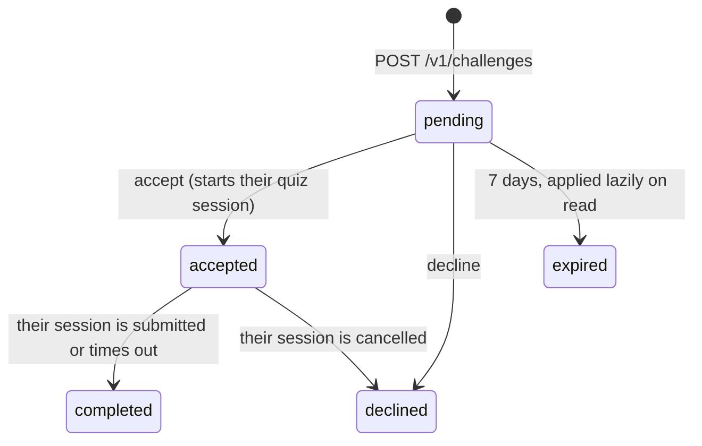

# Social: following other learners

Learners can find each other by name, follow each other and open each other's
profiles. This page records the rules that decide who can see what, and why
they're shaped the way they are.

Code: `services/api/app/social/`; web `apps/web/src/app/(app)/profile/{people,[userId]}`;
mobile `apps/mobile/src/app/(app)/profile/`.

## The privacy rule

Everything hangs on one setting, `account_settings.profile_public`, which is
**off by default**.

|                                          | Private (default)    | Public                                                                                   |
| ---------------------------------------- | -------------------- | ---------------------------------------------------------------------------------------- |
| Appears in search                        | No                   | Yes, by display name                                                                     |
| Can be followed                          | No                   | By any signed-in learner                                                                 |
| `GET /v1/users/{id}`                     | 404 to everyone else | Name, avatar, university, join date, counts and the same stats as their own Profile page |
| Listed as someone's follower or followee | No                   | Yes                                                                                      |
| Can follow public people                 | Yes                  | Yes                                                                                      |

- **Opt-in, not opt-out.** Turning on the feature for everyone at once would
  have made every existing learner searchable without asking them. The
  migration that adds the column leaves everyone private.
- **A public profile needs a display name** (422 `display_name_required`), both
  when switching it on and when clearing the name later. Search matches the
  name only, so a nameless public profile couldn't be found and would show up
  as "Unnamed" in other people's lists.
- **Private and unknown users get the same 404** (`user_not_found`). A
  different answer would confirm that a private account exists.
- **Going private doesn't delete follow rows.** Every read (search, lists,
  counts, profile) only counts users who are public _now_, so going private
  hides someone everywhere at once, and switching back restores their
  followers. Unfollowing and removing a follower still work against a private
  user, because they reveal nothing.
- **What is never shared:** email, lesson content, notes, highlights,
  flashcards and individual answers. A public profile shows aggregates only,
  computed by the same `build_profile_stats` (`app/users/stats.py`) that
  serves `/v1/me/stats`.

## Why one-way follow

There are no friend requests. Following is one-way and needs no approval;
the followee decides whether they can be followed at all through the setting
above. This keeps the model to one table (`follows`, PK
`(follower_id, followee_id)`) and one rule, instead of a request state machine.
`is_following` and `follows_you` on every row tell the client when a follow is
mutual, which features that need consent from both sides (challenges) build on.

You can remove a follower (`DELETE /v1/me/followers/{id}`). There is no block
yet: a removed follower can follow again while you are public.

## Endpoints

| Method        | Path                                   | Notes                                                                                                                                                                 |
| ------------- | -------------------------------------- | --------------------------------------------------------------------------------------------------------------------------------------------------------------------- |
| GET           | `/v1/users/search?q=`                  | Public users whose name contains `q` (2–50 characters, `%` and `_` matched literally), excluding the caller, sorted by name, at most 20. Shorter queries return `[]`. |
| GET           | `/v1/users/{id}`                       | `PublicProfileResponse`; 404 unless public or the caller.                                                                                                             |
| POST / DELETE | `/v1/users/{id}/follow`                | Idempotent; 204. Following yourself is a 400.                                                                                                                         |
| DELETE        | `/v1/me/followers/{id}`                | 204.                                                                                                                                                                  |
| GET           | `/v1/me/following`, `/v1/me/followers` | Public users only.                                                                                                                                                    |

Search uses `ILIKE '%q%'` with no index. That is fine for one institution's
learners; a `pg_trgm` index is the follow-up if the user count grows.

## Clients

Social lives under Profile on both platforms rather than in a new tab (the
phone tab bar already has six): your Profile shows follower and following
counts and a "Find people" button, which open `/profile/people` (Search,
Following and Followers). Each row opens `/profile/[userId]`, which renders the
shared `ProfileStats` block. Settings → Privacy holds the switch.

The query keys are shared by both apps: `["user-search", q]`, `["following"]`,
`["followers"]`, `["user", id]`. Following flips every cached copy of the
button at once and puts it back if the request fails
(`apps/web/src/lib/use-follow.ts`, `apps/mobile/src/lib/social.tsx`).

## Activity

Followers see a short feed of what the people they follow have done:
completed a lesson, finished an exam (with the score), reached a streak of 3, 7,
14, 30, 50 or 100 days and every hundred after that. It shows on your Profile
(latest five, only once you follow someone), in full on the People screen's
Activity tab, and per learner on their public profile.

**Recorded when it happens, not derived.** Lesson completion has no timestamp
of its own (it's the 80% ratio over `question_progress`), and rebuilding a feed
from several tables for every person you follow on every read would be the
slow way round. So `activity_events` is written as a side effect of the action:

| Kind                  | Written by                                                                                                      | Once per          |
| --------------------- | --------------------------------------------------------------------------------------------------------------- | ----------------- |
| `exam_completed`      | `quizzes/service.py::_finalize` (submit, timer expiry and the sweep; not cancel)                                | quiz session      |
| `lesson_completed`    | `progress/service.py::grade_and_record`, when a correct answer takes the lesson from not completed to completed | lesson, ever      |
| `streak_milestone`    | `daily/service.py::answer_today`                                                                                | milestone reached |
| `challenge_completed` | `challenges/completion.py`, for both participants                                                               | challenge         |

- `app/activity/recording.py::record_event` never commits and swallows a
  duplicate: the action already happened, and a missing feed line must not
  undo it. The unique index on `(user_id, kind, subject_id)` makes "once per
  lesson" hold under races too; streak events have no subject, and NULLs never
  collide.
- **No backfill.** The table starts empty. A lesson already completed before
  this shipped produces an event only if it drops below the threshold and
  crosses it again (and even then, only the first time).
- **Recorded for everyone, shown only while the author is public.** Going
  public later shows your recent history; going private hides it at once.
- `subject_id` has no foreign key, so deleting a lesson doesn't need to reach
  into this table. The reader drops events whose lesson is gone, and reads the
  title at read time, so a renamed lesson shows its current name.
- The recorder lives apart from the feed reader (`app/activity/feed.py`)
  because quizzes, progress and daily import it, and the reader needs
  `app.social`, which imports those modules back for profile stats. For the same
  reason the "is public" check is its own module, `app/social/visibility.py`.

`GET /v1/me/activity?before=&limit=` pages back by `created_at`;
`GET /v1/users/{id}/activity` has the same visibility as the profile. Each event
is flat (`document_title`, `score_percent`, `streak_days`, …) and the clients
build the sentence from `kind`, with the name and the lesson spliced in as links
by `rich()` so a translation can reorder them.

## Challenges

From a finished exam's results you can send that exact exam to someone: the
same questions, in the same order, with the same timer and reveal mode. Only
**mutual follows** can challenge each other (both public, both following),
which is the consent rule: nobody receives a challenge from a stranger.

- **The questions are read from the challenger's session**, not copied.
  Accepting calls `quizzes/service.py::create_session_from_questions`, the same
  builder a normal start now uses after drawing its random questions, so a
  challenge can't drift from what the challenger actually answered. The usual
  one-open-session rule applies (409 `session_already_open`).
- **Finishing the session completes the challenge.** `_finalize` calls
  `challenges/completion.py::on_session_finished`, which imports models only
  (`challenges/service.py` imports the quiz service, so the reverse would be a
  cycle). It records a `challenge_completed` event for both participants;
  followers see it only while **both** are public, since the opponent's name is
  theirs to show.
- **No peeking.** `opponent_score_percent` and the per-question comparison are
  null until the challenge is completed, so the challengee can't see the score
  to beat before answering.
- A finished exam can be sent to the same person once (unique on
  `(source_session_id, challengee_id)`). Expired sessions count as finished:
  they were graded.
- There are no push notifications yet. Incoming challenges show on the Exam
  Hub, with a count on its sidebar entry (web) and tab (mobile).
- Time taken isn't compared: a session's clock fields don't record active
  answering time reliably across pauses, so only scores and per-question
  outcomes are shown.
